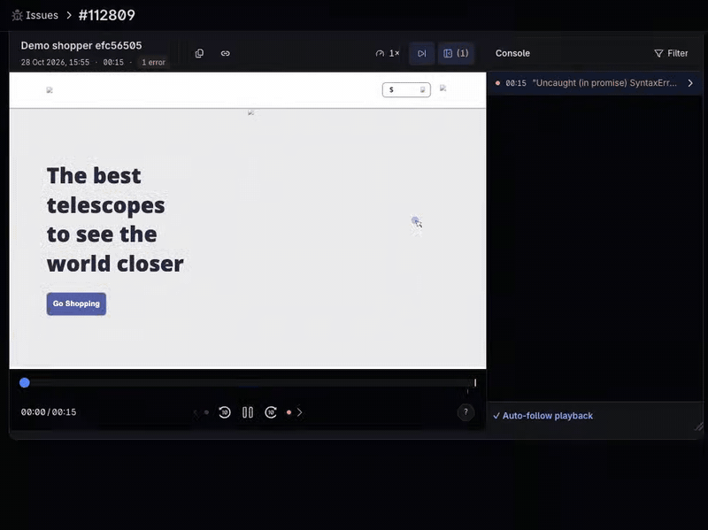
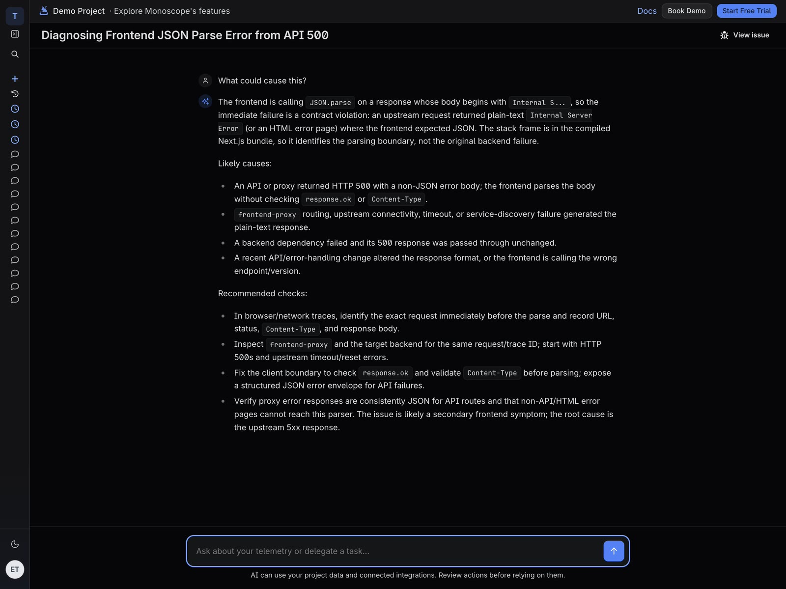
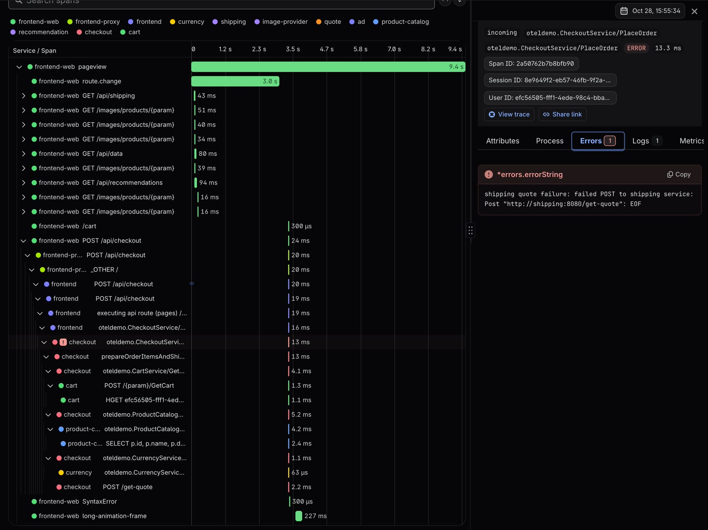
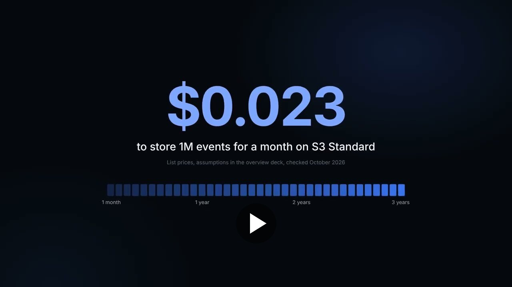

<!--
Blog copy of the newsletter. The Kit version (greeting, header image, sign-off, send notes)
is brand/newsletters/2026-10-a-shopper-clicked-place-order.md. Keep the two bodies in sync.
All captures: iPad Pro landscape (1366x1024, 4:3), public demo project, issue #112809, 2026-10-30.
-->

# A shopper clicked Place Order

A shopper on our demo store clicked Place Order, and the page crashed:

`SyntaxError: Unexpected token 'I', "Internal S"... is not valid JSON`

Monoscope grouped it into one issue with the shopper's name and ID, the stack trace, and the 94 events that led up to it. The error is in the browser, but the bug isn't. Here is how we found it, using three screens from that issue.

## Session replay

What the shopper saw: 15 seconds from the home page to the payment form, with the error marked on the timeline and in the console.

## AI diagnosis

Asked "What could cause this?", the AI read the issue and said the frontend was a symptom: an upstream service had returned a plain-text `Internal Server Error`, and the page tried to parse it as JSON.

## Trace

The trace says which service. The click went through `POST /api/checkout` into the checkout service, which asked the shipping service for a quote and failed:

`shipping quote failure: failed POST to shipping service: Post "http://shipping:8080/get-quote": EOF`

The shipping service dropped the connection, checkout returned `INTERNAL`, and the browser received an error page instead of JSON.

All three are on the issue page. [Open it yourself](https://app.monoscope.tech/p/00000000-0000-0000-0000-000000000000/issues/bf0881c3-cbe2-45f8-8975-66314a0fe1aa): the demo project needs no account.

New to Monoscope? We made a 100-second overview:

PS: When a frontend error turns out to be a backend bug, how do you usually find out? Reply and tell me.

*— Anthony Alaribe (Cofounder, Monoscope)*
